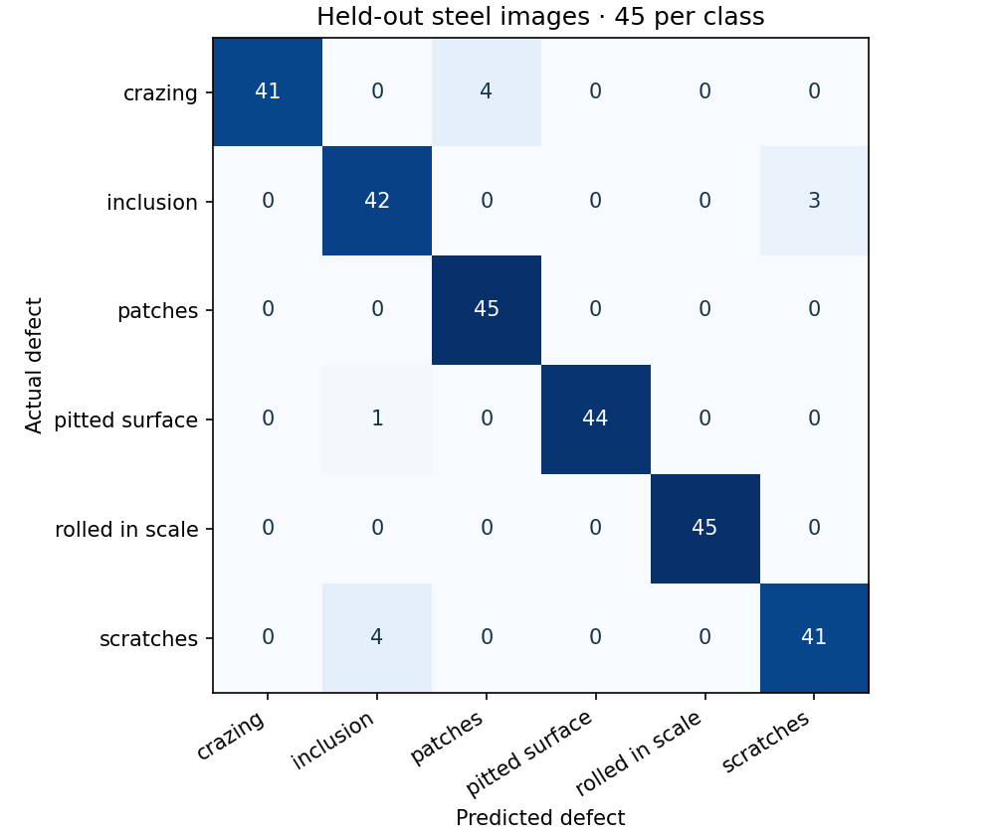

# Project 02 · Industrial Steel Surface Defect Classification

I built this PyTorch classifier to see how much a CNN could improve on a fully connected network using the same steel images. The selected CNN classified **258 of 270 held-out images correctly** (95.56% accuracy, 0.9557 macro F1). It has 5,318 trainable parameters and took a median of 4.30 ms to read one local crop and return its six class scores on an Intel Core i7-8650U CPU.

The [project report](PROJECT_REPORT.md) follows all six sessions, including the duplicate images I found, the changes that helped with scratches, the experiments that gained only one or two correct predictions, and what I would still need to check before using the model on a production line.

## Quick start

I ran the project with Python 3.14.6 and CPU PyTorch on Windows. From a terminal with an active Python environment, clone the series repository and start JupyterLab from the Project 02 folder.

```shell
git clone https://github.com/humaisali/Deep-Learning-Projects.git
cd Deep-Learning-Projects/02_Industrial_Steel_Surface_Defect_Classification
python -m pip install -r requirements.txt
python -m jupyterlab
```

Open [the inspection notebook](06_Steel_Inspection_and_Test_Evaluation.ipynb) and run its setup cell. In the next code cell, set `image_path` to your own local defect crop and run it. The output shows the grayscale input, predicted defect, six softmax scores and elapsed time. The saved checkpoint and selection record are included. The default sample and the full held-out evaluation require the NEU-CLS images described below.

## Portfolio results

I used one split of 1,260 training, 270 validation and 270 test images. I selected checkpoints using validation macro F1 and scored the optimized CNN on the held-out test set in Session 6.

| Model | Trainable parameters | Validation macro F1 |
|---|---:|---:|
| Fully connected ANN | 2,560,454 | 0.5011 |
| Basic CNN | 2,918 | 0.7118 |
| Deeper CNN | 5,238 | 0.8480 |
| Deeper CNN with batch normalization | 5,318 | 0.9408 |
| Optimized CNN | 5,318 | 0.9816 |

The ANN assigns separate weights to each pixel position. A convolution reuses the same local filter across the surface. The basic CNN gained 0.2107 validation macro F1 over the ANN with 2,918 parameters. In Session 3 I shifted a scratch and tracked its movement in a learned feature map. My final model used three convolutional blocks, batch normalization, training-only flips and brightness changes, and Adam at 0.0006.



On the test split, four scratches were classified as inclusion and three inclusions as scratches. Together they account for seven of twelve errors. Four crazing images were called patches, and one pitted surface was called inclusion. I originally expected crazing and rolled-in scale to be confused. The final model made zero errors between those two classes on this split.

| Warm batch-one CPU latency | Median | 95th percentile |
|---|---:|---:|
| Model forward pass on a normalized tensor | 2.24 ms | 7.66 ms |
| Open local image through label and six scores | 4.30 ms | 7.77 ms |

Each timing path used 30 warm-up calls and 270 measured images on Windows, with PyTorch 2.13.0+cpu and four threads on an Intel Core i7-8650U. The model was resident in memory and file data could be cached. Camera acquisition and rendering fall outside the measurement.

NEU-CLS contains six defect classes. This evaluation measures classification of individual defect crops under the benchmark conditions. Production pass/fail inspection would require defect-free examples and validation on the production camera and steel. The [test report](Artifacts/final_test_report.json) contains per-class precision, recall and F1, all 270 predictions, hardware details and the checkpoint digest.

## Reproduce the six sessions

Download the authors' NEU-CLS archive. Extract its `NEU-CLS` folder into `Dataset` under this project and check that `Dataset/NEU-CLS/Cr_1.bmp` exists. The archive used for these runs has SHA-256 `a85bcc6bfa1a40e76f28079e135694aaf5f6a4ee01203f7eaacff0ebafaa96f8`. [Official NEU dataset, download and citation](https://faculty.neu.edu.cn/songkc/en/zdylm/263265/)

Run the notebooks in order from this folder using the same Python environment. The dataset has 300 images per class. Session 1 groups exact duplicates before splitting, then writes each image path, class, pixel hash and split to the [manifest](Artifacts/split_manifest.csv). Rerunning training can replace the included checkpoints and reports.

| Session | What I tested |
|---|---|
| [1. Explore the images](01_Explore_Steel_Surface_Images.ipynb) | Audit image format and duplicates, freeze the split and inspect a grayscale tensor. |
| [2. Fully connected baseline](02_Fully_Connected_Baseline.ipynb) | Train on flattened pixels and identify the ANN's two most common errors. |
| [3. Basic CNN](03_Basic_CNN.ipynb) | Compare shared filters with dense weights and trace a shifted scratch through a feature map. |
| [4. Depth and batch normalization](04_Depth_and_Batch_Normalization.ipynb) | Test a third block, then batch normalization, and track scratch recall. |
| [5. Optimize the CNN](05_Optimize_the_CNN.ipynb) | Compare flips, brightness and learning rate, then freeze the [selected checkpoint](Artifacts/session5_selection.json). |
| [6. Inspect and evaluate](06_Steel_Inspection_and_Test_Evaluation.ipynb) | Run single-image inspection, score the held-out split and measure CPU latency. |

The [project report](PROJECT_REPORT.md) records the decisions and errors session by session. The [final test results](Artifacts/final_test_report.json) include the per-class metrics, all 270 predictions, checkpoint digest and timing protocol.
